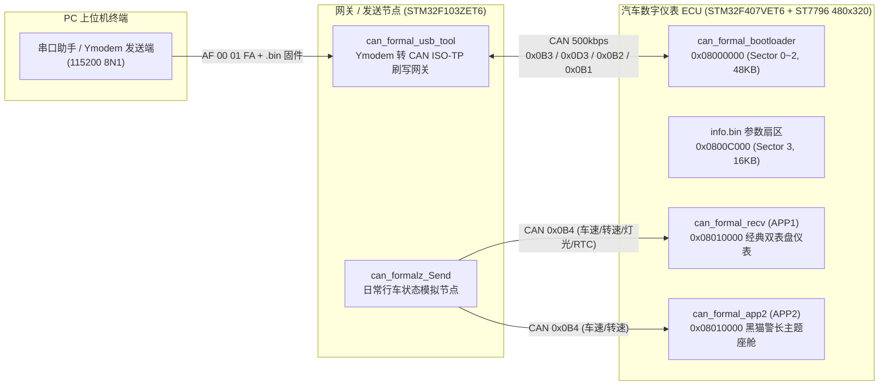

# 基于 STM32F407 + STM32F103 的车载 CAN 数字仪表盘与 ISO-TP 远程 OTA 刷写系统

> **项目定位**：对标汽车电子 HIL（硬件在环）桌面实验台架，采用 **STM32F103ZET6（数据网关 / 刷写诊断仪）+ STM32F407VET6（汽车数字仪表 ECU）** 双节点物理 CAN 2.0B 网络架构，完整实现 **LVGL 8.3.11 双主题仪表渲染**、**车载 CAN 报文矩阵通信**、**三段式 Flash Bootloader** 以及 **Ymodem + ISO 15765-2 (ISO-TP) 跨 CAN 网络双 APP 无缝互相刷写**。

---

## 一、系统总体架构与通信拓扑

---

## 二、硬件平台、BOM 物料清单与完整引脚接线表

### 2.1 核心硬件选型与 BOM 清单

| 模块角色 | 硬件型号 / 规格 | 数量 | 核心参数与用途说明 |
| :--- | :--- | :---: | :--- |
| **汽车仪表主控 ECU** | **STM32F407VET6 开发板**（立创天空星） | 1 | Cortex-M4F 内核，主频 **168 MHz**，512 KB Flash，192 KB SRAM，硬件浮点单元 (FPU) 加速 LVGL 指针旋转渲染 |
| **数据网关 / 发送节点** | **STM32F103ZET6 开发板** | 1 | Cortex-M3 内核，主频 **72 MHz**，512 KB Flash，64 KB SRAM，负责 UART(Ymodem) ⇄ CAN(ISO-TP) 协议转换与车辆状态广播 |
| **车载液晶显示屏** | **3.5 寸 TFT-LCD (ST7796S)** | 1 | 分辨率 **480 × 320**（横屏 RGB565），通过硬件 **SPI1 (42 Mbit/s)** 极速刷屏 |
| **CAN 总线收发器** | **SN65HVD230 / TJA1050 模块** | 2 | 将 MCU 的 `CAN_TX/RX` TTL 逻辑电平转换为差分物理信号 `CANH / CANL`（两端并联 120Ω 终端电阻） |
| **串口通信模块** | **USB-TTL 模块 (CH340 / CP2102)** | 1~3 | 连接网关 `USART2` 发送 Ymodem 升级固件与控制指令，可选接 `USART1` / F407 `USART2` 查看实时调试日志 |

---

### 2.2 接收端仪表 ECU（`STM32F407VET6`）完整引脚接线表

#### （1）3.5 寸 ST7796S SPI 液晶屏接线（硬件 SPI1 + GPIO 控制）

| 屏幕引脚 | STM32F407VET6 引脚 | 外设 / 模式 | 功能说明 |
| :--- | :---: | :--- | :--- |
| **`VCC`** | **`3.3V / 5V`** | 电源 | 屏幕供电 |
| **`GND`** | **`GND`** | 电源地 | 共地 |
| **`SCK` (SCL)** | **`PA5`** | `SPI1_SCK` (AF5) | 硬件 SPI1 串行时钟（42 MHz） |
| **`SDA` (MOSI)** | **`PA7`** | `SPI1_MOSI` (AF5) | 硬件 SPI1 主机输出数据 |
| **`CS`** | **`PD1`** | `GPIO_Output` | 液晶屏片选信号（低电平有效） |
| **`RES` (RST)** | **`PD4`** | `GPIO_Output` | 液晶屏硬件复位引脚 |
| **`DC` (RS)** | **`PD15`** | `GPIO_Output` | 数据 / 命令选择引脚（高=数据，低=命令） |
| **`BLK`** | **`PE8`** | `GPIO_Output` | 液晶屏背光控制引脚 |

#### （2）CAN 收发器与调试串口接线（`STM32F407VET6`）

| 外设功能 | STM32F407VET6 引脚 | 对接目标模块引脚 | 波特率 / 参数说明 |
| :--- | :---: | :--- | :--- |
| **`CAN1_RX`** | **`PB8`** (AF9) | F407 侧 CAN 收发器 **`RXD (R)`** | **500 kbps**（APB1=42MHz, Prescaler=7, BS1=9TQ, BS2=2TQ, 采样点 83.33%） |
| **`CAN1_TX`** | **`PB9`** (AF9) | F407 侧 CAN 收发器 **`TXD (D)`** | 同上 |
| **`USART2_TX`** | **`PA2`** (AF7) | USB-TTL 的 **`RXD`** | **115200 8N1**（打印 Bootloader 与 APP 运行状态日志，可选接） |
| **`USART2_RX`** | **`PA3`** (AF7) | USB-TTL 的 **`TXD`** | 同上 |

---

### 2.3 网关 / 发送节点（`STM32F103ZET6`）完整引脚接线表

| 外设功能 | STM32F103ZET6 引脚 | 对接目标模块引脚 | 波特率 / 参数与用途说明 |
| :--- | :---: | :--- | :--- |
| **`USART2_TX`（主通道）** | **`PA2`** | 电脑 USB-TTL 的 **`RXD`** | **115200 8N1（必接）**：向电脑输出 `Waiting for the file...` 及 Ymodem `C` 握手信号 |
| **`USART2_RX`（主通道）** | **`PA3`** | 电脑 USB-TTL 的 **`TXD`** | **115200 8N1（必接）**：接收 `AF 00 01 FA` 升级指令、Ymodem `.bin` 固件包，或 `0xAF` 仪表控制指令 |
| **`CAN1_RX`** | **`PA11`** | ZET6 侧 CAN 收发器 **`RXD (R)`** | **500 kbps**（APB1=36MHz, Prescaler=6, BS1=9TQ, BS2=2TQ, 采样点 83.33%） |
| **`CAN1_TX`** | **`PA12`** | ZET6 侧 CAN 收发器 **`TXD (D)`** | 同上 |
| **`USART1_TX`（日志口）** | **`PA9`** | 第二个 USB-TTL 的 **`RXD`** | **115200 8N1（可选）**：打印网关内部进度（如 `cnt:179 addr:8061800`、`Programming Completed!`） |
| **`USART1_RX`（日志口）** | **`PA10`** | 第二个 USB-TTL 的 **`TXD`** | 同上 |

#### 双板 CAN 总线物理互联：
* **ZET6 收发器 `CANH` ── 接 ── F407 收发器 `CANH`**
* **ZET6 收发器 `CANL` ── 接 ── F407 收发器 `CANL`**
* **ZET6 的 `GND` ── 接 ── F407 的 `GND`**

---

## 三、五大正式工程目录说明

| 工程文件夹 | 目标芯片 | Flash 起始地址 | 核心职责与功能说明 |
| :--- | :--- | :--- | :--- |
| [`can_formal_bootloader`](./can_formal_bootloader) | `STM32F407VET6` | `0x08000000` (48 KB) | **接收端 Bootloader**：上电校验 Sector 3 (`0x0800C000`) 的 `ota_flag`；`ota_flag=0` 时校验栈顶 `MSP` 并跳转 `0x08010000`；`ota_flag=1` 时擦除 Sector 4~7、回复 `0x0D3` 应答、运行 ISO-TP 服务接收 2KB 固件块写入 Flash。 |
| [`can_formal_recv`](./can_formal_recv) | `STM32F407VET6` | `0x08010000` (448 KB) | **APP1（经典双表盘数字仪表）**：车速/转速双指针 66FPS 阻尼逼近、水温/安全带/远近光/转向灯状态显示、RTC 掉电时钟校准；收到 `0x0B3` 自动置位 `ota_flag=1` 并软复位回 Bootloader。产物：[`APP_Car.bin`](./can_formal_recv/APP_Car.bin)。 |
| [`can_formal_app2`](./can_formal_app2) | `STM32F407VET6` | `0x08010000` (448 KB) | **APP2（黑猫警长主题 LVGL 座舱）**：50FPS 动态座舱渲染、CAN `0x0B4` 在线联动与离线巡航演示；同样支持收到 `0x0B3` 置位 `ota_flag=1` 软复位回 Bootloader，实现 **APP1 ⇄ APP2 无限次互升**。产物：[`app2_agy.bin`](./can_formal_app2/app2_agy.bin)。 |
| [`can_formal_usb_tool`](./can_formal_usb_tool) | `STM32F103ZET6` | `0x08000000` (512 KB) | **CAN OTA 升级网关**：串口 2 (`PA2/PA3`) 接收电脑 `AF 00 01 FA` 握手指令，发送 `0x0B3` 唤醒 F407 并等待 `0x0D3` 擦除完成应答，随后通过 Ymodem 接收 `.bin` 文件并按 2048B 分块经 ISO-TP (`0x0B2`) 刷写 F407。 |
| [`can_formalz_Send`](./can_formalz_Send) | `STM32F103ZET6` | `0x08000000` (512 KB) | **车辆状态 CAN 发送端**：串口 2 接收 8 字节控制指令（带 `0xAF` 帧头防错位对齐），封装为 `0x0B4` 标准帧广播至 CAN 总线，实时控制仪表指针、报警灯与 RTC 日期时间。 |

---

## 四、STM32F407VET6 内部 Flash 分区设计

| 扇区编号 | 地址范围 | 容量 | 分区角色 | 关键设计说明 |
| :--- | :--- | :--- | :--- | :--- |
| **Sector 0 ~ 2** | `0x08000000 ~ 0x0800BFFF` | 48 KB | **Bootloader 区** | 存放引导程序、Flash 擦写驱动与 ISO-TP 协议栈，升级过程中永不擦除，确保断电不变砖。 |
| **Sector 3** | `0x0800C000 ~ 0x0800FFFF` | 16 KB | **参数区 (`info.bin`)** | 存放 12 字节配置结构体（魔数 `AA BB CC DD` + 版本号 + `ota_flag` + 校验和），跨软复位传递升级请求。 |
| **Sector 4 ~ 7** | `0x08010000 ~ 0x0807FFFF` | 448 KB | **用户 APP 区** | 存放 `APP_Car.bin` (397 KB) 或 `app2_agy.bin` (359 KB)，APP 入口通过 `SCB->VTOR = 0x08010000` 重映射向量表。 |

---

## 五、CAN 总线通信矩阵 (`500 kbps`，采样点 `83.33%`)

| CAN ID | 方向 | 报文名称 | 长度 | 载荷定义与作用 |
| :--- | :--- | :--- | :--- | :--- |
| **`0x0B3`** | ZET6 → F407 | `CAN_ID_CALL_OTA` | 8 B | `BE AD BE EF 01 AA AA AA`：请求进入 OTA 升级模式 `BE AD BE EF 02 AA AA AA`：通知固件传输结束，校验并跳转新 APP |
| **`0x0D3`** | F407 → ZET6 | `CAN_ID_CALL_OTA_ACK` | 8 B | `BE AD BE EF 01 AA AA AA`：F407 已擦除完 Sector 4~7，通知网关启动 Ymodem |
| **`0x0B2`** | ZET6 → F407 | `CAN_ID_OTA_SEND` | 8 B | ISO 15765-2 (ISO-TP) 首帧 (FF) 与连续帧 (CF)，每次传输 `2048B + 9B包头` |
| **`0x0B1`** | F407 → ZET6 | `CAN_ID_OTA_RECV` | 8 B | ISO 15765-2 (ISO-TP) 流控帧 (FC)，控制网关发送节奏 |
| **`0x0B4`** | ZET6 → F407 | `CAN_ID_UI` | 8 B | 帧头 `0xAF` + 子功能码 `0x01~0x07`（车速/转速/水温/安全带/车灯/转向灯/RTC校准） |

---

## 六、快速上手与 OTA 升级演示步骤

1. **首次烧录**：
   * 将 [`can_formal_bootloader`](./can_formal_bootloader) 编译生成的 `.hex` 烧录至 `STM32F407VET6`（地址 `0x08000000`），将 [`can_formal_recv`](./can_formal_recv) 烧录至 `0x08010000`。
   * 将 [`can_formal_usb_tool`](./can_formal_usb_tool) 烧录至网关板 `STM32F103ZET6`（地址 `0x08000000`）。
2. **硬件接线**：
   * 两板收发器 `CANH` 接 `CANH`、`CANL` 接 `CANL`、`GND` 共地。
   * 电脑 USB-TTL 接网关板 `STM32F103ZET6` 的 **串口 2 (`PA2` TX / `PA3` RX)**，波特率 `115200 8N1`。
3. **一键触发 CAN OTA 升级**：
   * 串口助手向 ZET6 串口 2 按 HEX 发送 `AF 00 01 FA`。
   * F407 自动软复位进入 Bootloader 并擦除 APP 扇区（耗时约 3 秒），随后电脑串口收到 `CCCCC...` 握手信号。
   * 使用 Ymodem 协议发送 [`app2_agy.bin`](./can_formal_app2/app2_agy.bin)（黑猫警长）或 [`APP_Car.bin`](./can_formal_recv/APP_Car.bin)（双表盘），进度条走完 100% 后屏幕立即点亮新主题！
