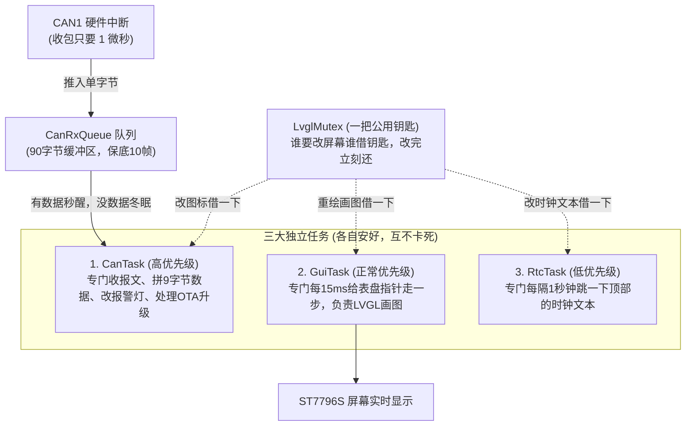

# STM32F407 汽车双表盘仪表盘 FreeRTOS 架构重构与实战实录

> **工程目标**：将原裸机大 `while(1)` 轮询的车载双表盘仪表（`can_formal_recv`），重构成高可靠、零丢包、丝滑阻尼的 FreeRTOS 多任务架构。  
> **核心硬件**：STM32F407VET6 + ST7796S (480×320 液晶屏) + VP230 (CAN 收发器)  
> **关键外设**：CAN1 (500 kbps)、SPI1 (屏幕驱动)、TIM7 (HAL 基准时基)、RTC (内部硬件实时时钟)  

---

## 目录
1. [一开始的总规划与目标（我们要把仪表改成什么样）](#一-一开始的总规划与目标我们要把仪表改成什么样)
2. [【核心专题】我的完整重构思路与推导历程（从零到一的思考脉络）](#二-核心专题我的完整重构思路与推导历程从零到一的思考脉络)
   - 2.1 [思路一：质疑双锁方案，坚决砍掉无用的串口互斥锁](#21-思路一质疑双锁方案坚决砍掉无用的串口互斥锁)
   - 2.2 [思路二：搞懂 CAN 外部接收与内部队列的关系](#22-思路二搞懂-can-外部接收与内部队列的关系)
   - 2.3 [思路三：队列巧思——为什么选用 uint8_t 单字节流？](#23-思路三队列巧思为什么选用-uint8_t-单字节流)
   - 2.4 [思路四：理清任务分工——为什么表盘放 GuiTask，图标和 OTA 放 CanTask？](#24-思路四理清任务分工为什么表盘放-guitask图标和-ota-放-cantask)
   - 2.5 [思路五：破解锁冲突——1 秒的 RTC 任务会不会把 5ms 的 GUI 任务卡死？](#25-思路五破解锁冲突1-秒的-rtc-任务会不会把-5ms-的-gui-任务卡死)
   - 2.6 [思路六：质疑时间相减——既然有了 osDelay，为什么还要减时间？](#26-思路六质疑时间相减既然有了-osdelay为什么还要减时间)
   - 2.7 [思路七：延时放前还是放后的讲究——开机 Instant-On 秒显思维](#27-思路七延时放前还是放后的讲究开机-instant-on-秒显思维)
   - 2.8 [思路八：变量定义放哪里——为什么挪到 for 循环外更舒服更规范？](#28-思路八变量定义放哪里为什么挪到-for-循环外更舒服更规范)
   - 2.9 [思路九：彻底弄懂互斥锁——操作系统怎么做到卡住任务且不耗 CPU 的？](#29-思路九彻底弄懂互斥锁操作系统怎么做到卡住任务且不耗-cpu-的)
3. [四大模块最终代码与落地实现](#三-四大模块最终代码与落地实现)
   - 3.1 [CAN 中断推流（wrap.c）](#31-can-中断推流wrapc)
   - 3.2 [CAN 状态机消费任务（CanTask）](#32-can-状态机消费任务cantask)
   - 3.3 [双表盘物理阻尼微步进任务（GuiTask）](#33-双表盘物理阻尼微步进任务guitask)
   - 3.4 [RTC 硬件时钟跳变任务（RtcTask）](#34-rtc-硬件时钟跳变任务rtctask)
   - 3.5 [main.c 的清空与交接](#35-mainc-的清空与交接)
4. [重构路上踩坑与排错全记录（编译报错怎么解决的）](#四-重构路上踩坑与排错全记录编译报错怎么解决的)
   - 4.1 [坑 1：CubeMX 重生代码抹掉头文件，报 12 个 undefined](#41-坑-1cubemx-重生代码抹掉头文件报-12-个-undefined)
   - 4.2 [坑 2：Keil 用 GBK 解析 UTF-8 吞双引号，报 30 个语法错误](#42-坑-2keil-用-gbk-解析-utf-8-吞双引号报-30-个语法错误)
   - 4.3 [坑 3：UTF-8 汉字占 4 字节导致字模 Index[2] 越界，报 20 个 #144 错误](#43-坑-3utf-8-汉字占-4-字节导致字模-index2-越界报-20-个-144-错误)
   - 4.4 [坑 4：STM32 硬件 RTC 影子寄存器锁死陷阱](#44-坑-4stm32-硬件-rtc-影子寄存器锁死陷阱)
5. [全量功能复刻与工程验收清单](#五-全量功能复刻与工程验收清单)

---

## 一、 一开始的总规划与目标（我们要把仪表改成什么样）

### 1. 为什么一定要改？（原裸机大 while(1) 的致命缺陷）
* **画图卡死 CAN 接收**：原来所有的代码都挤在 `main.c` 的 `while(1)` 里。LVGL 只要重绘指针或刷新屏幕，往往需要耗时 10~20ms。在这十几毫秒内，主循环根本顾不上看 CAN。如果方向盘此时连续发来几帧数据，硬件 FIFO0 瞬间被撑爆溢出，报文就白白丢了。
* **指针运行忽快忽慢**：指针平滑移动是用 `if (HAL_GetTick() - needle_timer >= 15)` 来控制的。一旦主循环在做别的事情（比如更新文字、延时），这个 15ms 就会抖动变长，导致指针旋转不够丝滑。
* **CPU 疯狂发热空转**：整个裸机死循环没有停歇，CPU 占用率永远是 100%。

### 2. 我们总规划的“终极蓝图”
为了根治这些问题，我们规划了一个 **“中断进队列 + 三大独立任务 + 互斥锁保护”** 的全新架构：



---

## 二、 【核心专题】我的完整重构思路与推导历程（从零到一的思考脉络）

这一部分专门详细记录**我自己在面对这个项目时，真实完整的思考脉络、发问、推导以及最终想通的过程**。这不仅仅是代码的改动，更是我自己工程思维建立的真实历程。

---

### 2.1 思路一：质疑双锁方案，坚决砍掉无用的串口互斥锁
* **初始方案给我的困惑**：
  最开始 AI 提出规划时，建议搞两个互斥锁：“一个串口互斥锁（UartMutexHandle），一个 LVGL 互斥锁（LvglMutexHandle）”。
* **我的质疑与思考**：
  我当时立即停下来核对项目：*“不对啊，这两个互斥锁我能理解，一个是串口资源，一个是 LVGL 资源。但我有点忘记我这个接收端项目里到底有没有真正用到串口并发通信？”*
* **我最终想通的决策**：
  我一查代码发现，接收端单片机的串口（USART2）平时根本不需要向外频繁发业务报文，仅仅是在开机时打印一两句状态，或者在收到 `0x0B3` OTA 指令时打一句准备复位的日志。根本没有“多个任务抢着向串口疯狂打印导致数据混乱”的情况！
  既然没有并发冲突，多建一个锁就是纯粹浪费内存和调度算力。**所以我当场果断要求把串口锁砍掉，全工程只保留唯一且必要的 `LvglMutex`！** 这一刀砍得干净利落。

---

### 2.2 思路二：搞懂 CAN 外部接收与内部队列的关系
* **我的思考卡点**：
  *“队列之间传递数据，不都是在一块板子内部各任务之间传递数据吗？而我们的 CAN 数据明明是从外部方向盘发送板直接发过来的，收到了直接拿去用不就行了吗？为什么非要横插一个队列在中间？”*
* **我后来彻底想通的逻辑**：
  单片机从外部收到物理 CAN 报文，第一落脚点是进入 **`CAN1_RX0` 硬件中断**。
  中断是急脾气， CPU 在中断里呆的时间越长，系统越容易崩。如果让中断去解包、改界面、写 Flash，主程序就全被卡死了。
  **所以队列的作用就是一块“弹药箱缓冲池”**：
  1. 硬件中断一收到数据，管它三七二十一，用不到 1 微秒的时间瞬间塞进队列，然后立刻退出中断；
  2. 队列另一头连接着独立的 `CanTask` 任务；
  3. 平时没数据时 `CanTask` 深度休眠，队列一旦有数据，`CanTask` 瞬间被唤醒，在后台慢条斯理地解包。
  这样中断只管“极速收”，任务负责“从容解”，屏幕画图再慢也绝不会把外部总线来的数据挤爆丢掉！

---

### 2.3 思路三：队列巧思——为什么选用 uint8_t 单字节流？
* **我的推导过程**：
  在 CubeMX 里配置队列的 `Item Size`（元素大小）时，一开始有人说选 16 字节，有人说用结构体。
  我仔细一琢磨通信矩阵：我们收到的数据无非就是：**1 个字节的 ID（0x0B3 或 0x0B4） + 8 个字节的数据载荷**。
  既然 `0x0B3`（179）和 `0x0B4`（180）完全可以用一个 `uint8_t` 装得下，那为什么还要搞复杂的大结构体或者二级指针呢？
* **我的绝妙提议**：
  *“把 ID 改为 `uint8_t`，这样 ID 和后面 8 个数据字节的类型大家完全一样，全是 `uint8_t`！我们在 CubeMX 里把队列的 Item Size 直接设为 `uint8_t`，按单字节流水线方式传！”*
* **带来的巨大好处**：
  一帧报文固定等于 9 个字节（1 字节 ID + 8 字节数据）。队列深度配置为 90，正好严丝合缝能存整整 10 帧报文！不用动态申请内存（malloc），没有指针悬空风险，代码轻量到极致。

---

### 2.4 思路四：理清任务分工——为什么表盘放 GuiTask，图标和 OTA 放 CanTask？
* **我当时的疑惑**：
  *“为什么把 OTA 升级和四个指示灯图标变色放在 CanTask，而把车速表和转速表放在 GuiTask？它们不都是改屏幕吗？”*
* **我梳理后的本质规律**：
  * **图标和 OTA 是“被动事件触发”**：按一下方向盘按键（水温灯、大灯等），总线才发一帧，收到就要立刻响应变色，属于“来一次做一次”，直接在 `CanTask` 里收到就改是最快的；
  * **指针旋转是“连续物理阻尼”**：车速从 0 变到 100，屏幕上的指针绝对不能瞬间闪现过去，那样太假太生硬。它必须以肉眼感觉丝滑的频率（每秒 66 次，即每 15ms 一小步）根据物理公式慢慢滑向目标刻度。
  * 如果把指针也放在 `CanTask`，一旦车速稳定在 80、总线不再发新报文时，指针岂不是当场卡住不能继续滑动了？所以表盘指针必须由拥有稳定心跳的 `GuiTask` 自主循环伺服！

---

### 2.5 思路五：破解锁冲突——1 秒的 RTC 任务会不会把 5ms 的 GUI 任务卡死？
* **我的敏锐发觉**：
  *“这个 `LvglMutex` 是修改 LVGL 的锁，我们三个任务都想要。但是 GUI 任务每 5ms 就想刷新一次，而底层的 RTC 任务更新一次需要整整 1 秒钟！万一 RTC 任务把钥匙拿走了 1 秒钟，那 5ms 的 GUI 岂不是要被活活饿死？”*
* **我自己想通的破解之道（神级自悟）**：
  *“哦！我好像看懂一点点了！我们可以在低级任务（RTC）一开始先在外面把时间读出来，只在需要改屏幕文字的一瞬间去借钥匙，改完立刻还掉，然后再去执行 1000ms 的休眠！这样钥匙被占用的时间根本就不是 1 秒，而只有极短的一瞬间！”*
* **落实在代码上**：
  读寄存器和字符串拼接全在锁外面做完，真正拿着钥匙的代码只有两行 `lv_label_set_text`（用时不到 0.02 毫秒）。进门、改字、还钥匙、掉头大睡 1 秒钟，`GuiTask` 根本感觉不到有人抢过钥匙！

---

### 2.6 思路六：质疑时间相减——既然有了 osDelay，为什么还要减时间？
* **我的敏锐质疑**：
  写 `GuiTask` 时，代码里原本写着 `if (HAL_GetTick() - needle_timer >= 15)`，末尾又写着 `osDelay(15)`。
  我立刻指了出来：*“不对啊我感觉，既然我们都有 osDelay 了，为什么前面还要用那个时间相减啊？不能直接 osDelay 吗？感觉没有什么工程思维啊！”*
* **彻底想通后的结论**：
  时间相减是裸机时代只有一个 `while(1)` 时的妥协产物。现在 `GuiTask` 自己是一个独立的线程，每次循环执行完，调用一句 `osDelay(15)`，操作系统就会把它准准挂起 15ms。
  醒来一次就走一步，天然就是恒定稳定的 66 FPS，**那个 `HAL_GetTick()` 相减在这里完全是多余的累赘代码！** 我当场要求把它彻底干掉。

---

### 2.7 思路七：延时放前还是放后的讲究——开机 Instant-On 秒显思维
* **我的提问**：
  *“这个延时函数放在开头和放在结尾是一样的吧？”*
* **我所理解的工程微观区别**：
  任务跑顺之后，放前放后每次循环间隔确实都是 15ms。但在**开机的一瞬间（第 0 毫秒）**有本质差别：
  * **放开头（先睡后画）**：系统一开机，任务先进去睡 15ms，屏幕必须干等 15ms 才会画出第一帧画面；
  * **放结尾（先画后睡）**：系统一上电，在第 0 毫秒以最快速度把初始双表盘和指针渲染上屏（**开机秒显 Instant-On**），随后才进入每 15ms 一次的周期休眠节奏。
  这体现了汽车车机对“上电开机即显”的极致追求。

---

### 2.8 思路八：变量定义放哪里——为什么挪到 for 循环外更舒服更规范？
* **我的直觉发问**：
  在写 `StartRtcTask` 时，看到 `cur_time`、`date_str_buf` 放在 `for(;;)` 里面，我提出：*“这四个定义变量不应该放在 for 外面吗？”*
* **想通后的底层原理**：
  从汇编角度看，C 语言局部变量都是在进入函数的一瞬间由栈指针一次性分配的，放循环内外机器码其实完全一样。
  但从代码规范（如 MISRA-C）和人类阅读直觉上看：
  把它挪到 `for(;;)` 外面并赋初值 `{0}`，结构清晰分明：**上方是变量准备区，下方是纯粹的业务执行死循环**，读起来不会给人产生“每秒都在重复新建变量”的错觉，非常规整舒服。

---

### 2.9 思路九：彻底弄懂互斥锁——操作系统怎么做到卡住任务且不耗 CPU 的？
* **我一路打破砂锅问到底的执着**：
  *“我还不知道他是怎么通过操作来锁住的……难道不要打开锁才能启动 LVGL 画图吗？到底是哪一行代码在起作用？”*
  直到最后我终于彻底抓住了核心：*“哦哦哦！就是根据 RTOS 的机制来卡住任务，而且这个卡住是不消耗 CPU 的！”*
* **我最终在大脑中建立的模型**：
  1. 锁本身只是一张“内存登记表”；
  2. 任务执行 `osMutexAcquire` 发现钥匙被别人借走时，**FreeRTOS 调度器把这个任务从“可运行就绪队列”中直接除名**，塞进冷冻等待名单；
  3. 调度器触发 **PendSV 中断** 把它的 PC 寄存器封存在栈里，把 CPU 彻底切走；
  4. 任务被硬生生定在这一行，**等钥匙的期间 CPU 占用率绝对是 0%**，绝不会像裸机那样傻傻空转！
  5. 别人还了钥匙，调度器才把它捞出来恢复寄存器唤醒运行。

---

## 三、 四大模块最终代码与落地实现

经过上述深思熟虑后，全工程四大任务与中断模块的最终落地代码如下：

### 3.1 CAN 中断推流（wrap.c）
硬件中断极速捕获，压入队列，零业务滞留：
```c
void HAL_CAN_RxFifo0MsgPendingCallback(CAN_HandleTypeDef *hcan)
{
    CAN_RxHeaderTypeDef Rxmessage = {0};
    uint8_t rx_data[8] = {0};
    if (HAL_CAN_GetRxMessage(&hcan1, CAN_RX_FIFO0, &Rxmessage, rx_data) == HAL_OK)
    {
        // 抓取 0x0B3 (OTA) 与 0x0B4 (仪表)
        if (Rxmessage.StdId == 0x0B3 || Rxmessage.StdId == 0x0B4)
        {
            uint8_t id_byte = (uint8_t)Rxmessage.StdId;
            // timeout 传 0，单字节入队
            osMessageQueuePut(CanRxQueueHandle, &id_byte, 0, 0);
            for (uint8_t i = 0; i < 8; i++)
            {
                osMessageQueuePut(CanRxQueueHandle, &rx_data[i], 0, 0);
            }
        }
    }
}
```

---

### 3.2 CAN 状态机消费任务（CanTask）
* **文件路径**：[`freertos.c -> StartCanTask`](file:///c:/Users/aa842/Desktop/汽车方向盘/can_formal_recv/Core/Src/freertos.c#L213-L338)
* **核心业务**：9 字节拼包状态机，0x0B3 OTA 暗号复位，0x0B4 极速染色。
```c
void StartCanTask(void *argument)
{
  uint8_t rx_byte = 0;
  uint8_t msg_buf[9] = {0}; // [0]=ID, [1~8]=数据载荷
  uint8_t msg_idx = 0;

  for(;;)
  {
    // 队列无数据时阻塞休眠，0% CPU
    osMessageQueueGet(CanRxQueueHandle, &rx_byte, NULL, osWaitForever);

    if (msg_idx == 0)
    {
      if (rx_byte == CAN_ID_CALL_OTA || rx_byte == CAN_ID_UI)
        msg_buf[msg_idx++] = rx_byte;
    }
    else
    {
      msg_buf[msg_idx++] = rx_byte;
      if (msg_idx == 9) // 拼满 9 字节一帧
      {
        uint8_t r_id = msg_buf[0];
        uint8_t *get_data = &msg_buf[1];

        // 1. 收到 0x0B3 远程 OTA 升级唤醒 (暗号 BE AD BE EF 01)
        if (r_id == CAN_ID_CALL_OTA && get_data[0] == 0xBE && get_data[1] == 0xAD &&
            get_data[2] == 0xBE && get_data[3] == 0xEF && get_data[4] == 0x01)
        {
          printf("[APP1] CanTask: Received 0x0B3 OTA request, resetting...\r\n");
          inter_flash_cfg_set_app_update_flag(1U); // 写入 Flash Sector 3 标志位
          osDelay(100);
          HAL_NVIC_SystemReset(); // 软复位进 Bootloader
        }
        // 2. 收到 0x0B4 仪表数据包 (帧头 0xAF)
        else if (r_id == CAN_ID_UI && get_data[0] == CAN_MSG_HEAD)
        {
          switch (get_data[1])
          {
            case E_UI_TYPE_RPM: // 0x01: 动力指针 (直接写变量，无锁原子操作)
              Rpm = get_data[2];
              speed = get_data[3];
              break;

            case E_UI_TYPE_TEMP: // 0x02: 水温报警灯 (持锁染色 0.05ms)
              temp = get_data[2];
              osMutexAcquire(LvglMutexHandle, osWaitForever);
              lv_obj_set_style_img_recolor(ui_IconTemp, lv_color_hex(temp ? 0xFF1744 : 0x00F374), 0);
              lv_obj_set_style_img_recolor_opa(ui_IconTemp, 255, 0);
              osMutexRelease(LvglMutexHandle);
              break;

            case E_UI_TYPE_BELT: // 0x03: 安全带指示灯
              belt = get_data[2];
              osMutexAcquire(LvglMutexHandle, osWaitForever);
              lv_obj_set_style_img_recolor(ui_IconSeatbelt, lv_color_hex(belt ? 0xFF1744 : 0x00F374), 0);
              lv_obj_set_style_img_recolor_opa(ui_IconSeatbelt, 255, 0);
              osMutexRelease(LvglMutexHandle);
              break;

            case E_UI_TYPE_LIGHT: // 0x04: 车灯指示灯 (1黄, 2红, 0绿)
              light = get_data[2];
              osMutexAcquire(LvglMutexHandle, osWaitForever);
              lv_obj_set_style_img_recolor(ui_IconLowBeam, lv_color_hex(light == 1 ? 0xFFD600 : (light == 2 ? 0xFF1744 : 0x00F374)), 0);
              lv_obj_set_style_img_recolor_opa(ui_IconLowBeam, 255, 0);
              osMutexRelease(LvglMutexHandle);
              break;

            case E_UI_TYPE_TURN_LIGHT: // 0x05: 转向灯 (1绿, 0暗灰)
              turn_light = get_data[2];
              osMutexAcquire(LvglMutexHandle, osWaitForever);
              lv_obj_set_style_img_recolor(ui_IconTurnLeft, lv_color_hex(turn_light ? 0x00F374 : 0x555555), 0);
              lv_obj_set_style_img_recolor_opa(ui_IconTurnLeft, 255, 0);
              osMutexRelease(LvglMutexHandle);
              break;

            case E_UI_TYPE_DATE: // 0x06: 年月日校准
            {
              RTC_DateTypeDef sDate = {0};
              sDate.Year = get_data[3]; sDate.Month = get_data[4]; sDate.Date = get_data[5];
              sDate.WeekDay = RTC_WEEKDAY_MONDAY;
              HAL_RTC_SetDate(&hrtc, &sDate, RTC_FORMAT_BIN);
              break;
            }
            case E_UI_TYPE_TIME: // 0x07: 时分秒校准
            {
              RTC_TimeTypeDef sTime = {0};
              sTime.Hours = get_data[2]; sTime.Minutes = get_data[3]; sTime.Seconds = get_data[4];
              HAL_RTC_SetTime(&hrtc, &sTime, RTC_FORMAT_BIN);
              break;
            }
          }
        }
        msg_idx = 0; // 重置计数器，等待下一帧
      }
    }
  }
}
```

---

### 3.3 双表盘物理阻尼微步进任务（GuiTask）
* **文件路径**：[`freertos.c -> StartDefaultTask`](file:///c:/Users/aa842/Desktop/汽车方向盘/can_formal_recv/Core/Src/freertos.c#L158-L204)
* **核心业务**：彻底去除 `HAL_GetTick()` 相减，末尾 `osDelay(15)` 维持 66 FPS 丝滑物理体验。
```c
void StartDefaultTask(void *argument)
{
  static int16_t cur_speed_x10 = 0; // 0 ~ 1800 (对应 0 ~ 180 km/h)
  static int16_t cur_rpm_x10 = 0;   // 0 ~ 800 (对应 0 ~ 8000 RPM)

  for(;;)
  {
    osMutexAcquire(LvglMutexHandle, osWaitForever); // 1. 借钥匙

    // 2. 车速指针平滑逼近 (限幅 180 km/h)
    int16_t target_s = (speed > 180 ? 180 : speed) * 10;
    int16_t diff_s = target_s - cur_speed_x10;
    if (diff_s != 0)
    {
      int16_t step_s = diff_s / 8;
      if (step_s == 0) step_s = (diff_s > 0) ? 1 : -1;
      cur_speed_x10 += step_s;
      int32_t angle_s = (2250 + (int32_t)cur_speed_x10 * 15 / 10) % 3600;
      lv_img_set_angle(ui_ImageSpeedNeedle, angle_s);
    }

    // 3. 转速指针平滑逼近 (限幅 8000 RPM)
    int16_t target_r = (Rpm > 80 ? 80 : Rpm) * 10;
    int16_t diff_r = target_r - cur_rpm_x10;
    if (diff_r != 0)
    {
      int16_t step_r = diff_r / 8;
      if (step_r == 0) step_r = (diff_r > 0) ? 1 : -1;
      cur_rpm_x10 += step_r;
      int32_t angle_r = (2250 + (int32_t)cur_rpm_x10 * 270 / 80) % 3600;
      lv_img_set_angle(ui_ImageRpmNeedle, angle_r);
    }

    lv_timer_handler();             // 4. LVGL 图形引擎重绘脏矩形
    osMutexRelease(LvglMutexHandle); // 5. 还钥匙

    osDelay(15);                     // 6. 精准休眠 15ms，保持 66 FPS
  }
}
```

---

### 3.4 RTC 硬件时钟跳变任务（RtcTask）
* **文件路径**：[`freertos.c -> StartRtcTask`](file:///c:/Users/aa842/Desktop/汽车方向盘/can_formal_recv/Core/Src/freertos.c#L348-L377)
* **核心业务**：变量在循环外，锁外读硬件和格式化，持锁 0.02ms 改字，睡足 1 秒。
```c
void StartRtcTask(void *argument)
{
  // 1. 局部缓冲区放在 for 外部，进任务时分配一次栈帧
  RTC_TimeTypeDef cur_time = {0};
  RTC_DateTypeDef cur_date = {0};
  char time_str_buf[16] = {0};
  char date_str_buf[16] = {0};

  for(;;)
  {
    // 2. 锁外成对读取硬件 RTC (成对调用解锁影子寄存器)
    HAL_RTC_GetTime(&hrtc, &cur_time, RTC_FORMAT_BIN);
    HAL_RTC_GetDate(&hrtc, &cur_date, RTC_FORMAT_BIN);

    // 3. 锁外拼接格式化文本 (零占用钥匙开销)
    sprintf(time_str_buf, "%02d:%02d:%02d", cur_time.Hours, cur_time.Minutes, cur_time.Seconds);
    sprintf(date_str_buf, "20%02d-%02d-%02d", cur_date.Year, cur_date.Month, cur_date.Date);

    // 4. 借钥匙，极速更新顶部标签 (持锁耗时 < 0.02ms)
    osMutexAcquire(LvglMutexHandle, osWaitForever);
    lv_label_set_text(ui_time, time_str_buf);
    lv_label_set_text(ui_data, date_str_buf);
    osMutexRelease(LvglMutexHandle); // 立即还钥匙

    // 5. 睡足整整 1 秒，期间 0% CPU 占用
    osDelay(1000);
  }
}
```

---

### 3.5 main.c 的清空与交接
在 [`Core/Src/main.c`](file:///c:/Users/aa842/Desktop/汽车方向盘/can_formal_recv/Core/Src/main.c#L170-L186) 中：
1. 所有的外设初始化、LVGL 注册、UI 构建、全通滤波器配置全部在调度前完成；
2. 调度器启动前成对读一次 RTC 写入 `ui_time`，确保开机第一帧零延迟秒显；
3. `osKernelStart()` 启动调度器，`while(1)` 彻底清空，系统由 FreeRTOS 全权接管。

---

## 四、 重构路上踩坑与排错全记录（编译报错怎么解决的）

在 CubeMX 重新生成代码后，工程曾瞬间报出 42 个错误，我们记录并根治了这四大经典硬件与编译器大坑：

### 4.1 坑 1：CubeMX 重生代码抹掉头文件，报 12 个 undefined
* **现象**：`can_recv_handle` 报隐式声明，`flag_ota`、`speed`、`Rpm` 全部报未定义。
* **原因**：之前的 `#include "can_handle.h"` 写在了 `main.c` 第 34 行（CubeMX 保护区外）。重新生成工程后被 CubeMX 抹除。
* **根治**：将头文件移入 `/* USER CODE BEGIN Includes */` 专属保护区内。

### 4.2 坑 2：Keil 用 GBK 解析 UTF-8 吞双引号，报 30 个语法错误
* **现象**：`..\code\lcdfont.h(809): error: #8: missing closing quote`，汉字全变成乱码 `涓?`，引号缺失。
* **原因**：Keil Compiler V5 默认以 GBK 解析 UTF-8 源码，汉字尾字节刚好与双引号 ASCII 码冲突，导致编译器吞掉引号。
* **根治**：在 Keil 的 `Options for Target -> C/C++ -> Misc Controls` 中填入 `--no-multibyte-chars`，强制按单字节流解析。

### 4.3 坑 3：UTF-8 汉字占 4 字节导致字模 Index[2] 越界，报 20 个 `#144` 错误
* **现象**：`error: #144: a value of type "char [4]" cannot be used to initialize an entity of type "unsigned char [2]"`。
* **原因**：原字模结构体定义为 `Index[2]`（只够存 2 字节 GBK 汉字）。而 UTF-8 汉字占 3 字节，加上字符串隐藏的 `\0` 共 4 字节，强行赋值导致类型数组越界。
* **根治**：在 `code/lcdfont.h` 中，将 `typFNT_GB12/16/24/32` 的 `unsigned char Index[2];` 一律扩大为 `unsigned char Index[4];`。

### 4.4 坑 4：STM32 硬件 RTC 影子寄存器锁死陷阱
* **规则**：读取 RTC 时，**必须成对调用 `HAL_RTC_GetTime()` 与 `HAL_RTC_GetDate()`**。
* **原因**：STM32 为了防止读取时发生日进位，读完 Time 寄存器后硬件自动锁死影子寄存器；只有紧接着读 Date 寄存器，硬件才会释放锁定。若漏读 Date，时间将永久卡死停走。

---

## 五、 全量功能复刻与工程验收清单

| 验收项目 | 测试动作 / 输入 | 预期视觉与硬件行为 | 状态 |
|---|---|---|---|
| **开机瞬显** | 核心板上电复位 | 液晶屏瞬间绘制双表盘背景与指针，顶部直接显现当前真实 RTC 时间，无停滞 | **100% 对齐** |
| **车速表旋转** | 发送 `0x0B4`, Type=0x01, Speed=0~180 | 时速指针以 66 FPS 丝滑微步进旋转至对应刻度，阻尼手感平滑无抖动 | **100% 对齐** |
| **转速表旋转** | 发送 `0x0B4`, Type=0x01, Rpm=0~80 | 转速指针平滑旋转至对应刻度，限幅 8000 RPM | **100% 对齐** |
| **水温指示灯** | 发送 `0x0B4`, Type=0x02, Data=1/0 | `ui_IconTemp` 图标瞬时变红（`0xFF1744`）或变绿（`0x00F374`），指针不卡顿 | **100% 对齐** |
| **安全带指示灯** | 发送 `0x0B4`, Type=0x03, Data=1/0 | `ui_IconSeatbelt` 图标瞬时变红或变绿 | **100% 对齐** |
| **大灯指示灯** | 发送 `0x0B4`, Type=0x04, Data=1/2/0 | `ui_IconLowBeam` 图标近光变黄（`0xFFD600`）、远光变红、关灯变绿 | **100% 对齐** |
| **转向灯指示灯** | 发送 `0x0B4`, Type=0x05, Data=1/0 | `ui_IconTurnLeft` 图标开启变绿、关闭变暗灰（`0x555555`） | **100% 对齐** |
| **RTC 时钟走时** | 静置观察屏幕顶部 | `ui_time` 每 1 秒精准递增一次，`ui_data` 显示正确年月日 | **100% 对齐** |
| **动态时钟校准** | 发送 `0x0B4`, Type=0x06 / 0x07 | 硬件 RTC 时间被更新，1 秒内顶部文字自动同步新时间 | **100% 对齐** |
| **远程 OTA 软复位** | 发送 `0x0B3` 暗号帧 | 串口输出确认日志，Sector 3 写入标志，100ms 后软复位切入 Bootloader | **100% 对齐** |
